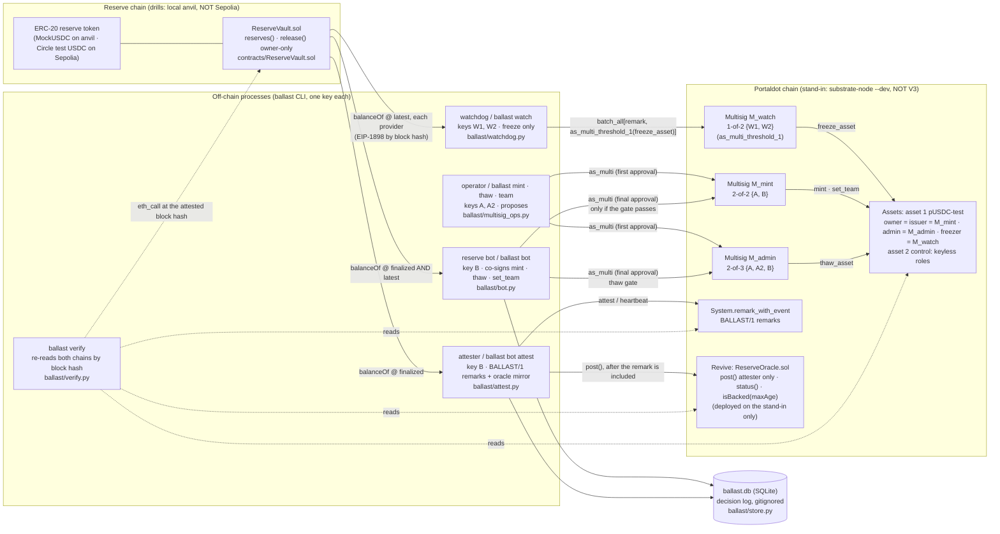

# Ballast — Architecture

> Generated from the code on 2026-10-14 (`a4bdcfa`, the code the stand-in drills ran on); updated 2026-10-20 for the V3 profile, seed-file keys,
> WebSocket RPC and `docs/PROOF.md`, which change no recorded stand-in result. Only components that exist in this repository are drawn; what is not built is listed
> at the end. **Everything measured so far ran on a labelled local stand-in chain (`standin-upstream`, NOT Portaldot V3) against a local
> anvil reserve chain (NOT Sepolia).** Every drill and receipt ran on the stand-in; the only V3 data is the read-only day-0 check
> of 2026-10-20 (`evidence/v3-day0-20261020T152616Z.json`). Nothing here is a Sepolia-vault measurement.

## What it is

Ballast protects a custodial test dollar, `pUSDC-test` (Assets pallet, asset 1), that is meant to be backed 1:1 by test USDC held in an
EVM vault. The protection is assembled from runtime modules, not from contract code:

- the **issuer** of the asset is a 2-of-2 multisig in which a reserve bot is a mandatory co-signer, so a mint needs the bot's signature, and the bot signs only when reserves cover it (the gate is bot code; see the trust caveat below);
- the **freezer** is a 1-of-N watcher multisig whose role is freezing (`freeze_asset`, `freeze`, `block`; its thaw is refused), so a reserve shortfall stops transfers a few blocks later (3 Portaldot blocks and 6.3 to 6.8 s wall clock in the scratch-asset drain drills; 5.5 to 8.4 s over the five role-split drills; one machine);
- the **admin** is a 2-of-3 multisig whose thaw the bot only co-signs once *finalized* reserves cover supply again.

Ballast is **not a trustless bridge**: the vault owner can still move the reserves. Ballast makes that visible and stops the shortfall from spreading.

## System diagram



## Components (all greppable)

| Component | Where | What it does |
|---|---|---|
| Chain profile | `ballast/chain_profile.py`, `ballast.toml` | identifies the chain by genesis hash and runtime `:code` hash, refuses a mismatch, derives H/K/W/N from the measured block time, labels every output (`v3` is pinned to the live V3 chain since the 2026-10-20 day-0 check) |
| Multisig helpers | `ballast/multisig.py`, `ballast/multisig_ops.py` | derives multisig accounts the way `pallet-multisig` does; propose / execute / cancel; the `as_multi` call-shape adapter |
| Dispatch decoding | `ballast/dispatch.py` | turns the inner `DispatchResult` of `MultisigExecuted` into `Pallet.Error` names from the chain's own metadata |
| Role map | `ballast/roles.py`, `deployments/standin-upstream.json` | who holds which Assets role; `audit_team` compares an on-chain team with the map |
| Reserve reader | `ballast/sepolia.py` | `balanceOf(vault)` from every provider independently, each at a pinned block hash; unreachable or disagreeing providers are reported, never trusted together |
| Watchdog | `ballast/watchdog.py` (`decide`, `Watchdog`) | polls the Portaldot head every N = 2 blocks over HTTP; freezes on deficit, on every provider down past 300 s, or on a silent bot (I8) |
| Reserve bot | `ballast/bot.py` (`mint_gate`, `thaw_gate`, `set_team_gate`) | the mandatory co-signer; logs every decision (signed or refused, with why) |
| Attestations | `ballast/attest.py`, `ballast/remarks.py` | `BALLAST/1` remarks on change and as a heartbeat; mirrors each included remark to the oracle |
| Verifier | `ballast/verify.py` | re-checks every remark and every asset event on both chains; REJECTS remarks from the wrong signer; flags thaws without the bot and weakened teams |
| Oracle client | `ballast/oracle.py`, `ballast/revive.py` | deploy / post / read `ReserveOracle` through `Revive` (hand-encoded `ReviveApi` calls) |
| Drill | `ballast/drill.py`, `scripts/role_drill.py`, `scripts/attest_drill.py` | scripted end-to-end runs that write evidence JSON |
| Receipts | `ballast/receipts.py`, `scripts/check_receipts.py` | renders `docs/RECEIPTS.md` from `evidence/*.json` and re-fetches every row by extrinsic id |
| Contracts | `contracts/ReserveVault.sol`, `contracts/ReserveOracle.sol`, `contracts/mocks/MockUSDC.sol` | see below; the mock exists for the local drills only |

### Contracts (Solidity 0.8.24)

- `ReserveVault`: `reserves()` returns `balanceOf(this)` of the reserve token; `release(to, amount, redeemId)` is `onlyOwner` and emits `Released`;
  `transferOwnership`. Deposits are plain ERC-20 transfers. It cannot stop its owner from draining it; the breaker on Portaldot is the guard.
- `ReserveOracle`: `post(s1, s2, reserves, sepBlock, sepHash, pdBlock, frozen)` callable only by the immutable `attester`, `pdBlock` must increase;
  `status()`; `isBacked(maxAge)` is `false` when never posted, frozen, older than `maxAge` seconds, or `reserves < s1 + s2`. It holds no value and
  cannot reach the Assets pallet, so it can never freeze or thaw anything.

## Role map

| Role on asset 1 | Account | Can | Cannot |
|---|---|---|---|
| owner, issuer | `M_mint`: 2-of-2 {A operator, B reserve bot} | `mint`, `set_team` | act without B's co-signature |
| admin | `M_admin`: 2-of-3 {A, A2 cold key, B} | `thaw_asset`, `burn`, `force_transfer` | thaw with fewer than two signatures |
| freezer | `M_watch`: 1-of-2 {W1, W2} via `as_multi_threshold_1` | `freeze_asset`, `freeze(who)`, `block` (other freezer-origin calls such as `touch_other` not drilled) | thaw (measured: `NoPermission`); mint and re-team belong to `M_mint` by role design (not drilled with a watcher key) |
| (Root) | whoever holds Root on the chain in use (stand-in: the `--dev` sudo key) | `force_asset_status` overrides everything | n/a: stated in the README trust model |

Asset 2 (`pUSDC-ctl`, control supply S2 = 50.00) is minted once; owner, issuer, admin and freezer then move to keyless accounts
`blake2_256("ballast:a2-<role>:v1")`, so S2 is fixed (`ballast/roles.py:30`). The `ReserveOracle` attester is B's H160 (mapped via `Revive.map_account`).

## Invariants, and where each is enforced

| # | Invariant | Enforced by | Exercised by |
|---|---|---|---|
| I1 | no over-mint: a mint executes only if `finalized` and `latest` reserves `>= S1 + S2 + amount` | `bot.py:145` `mint_gate`; the 2-of-2 `M_mint` makes B's signature mandatory | `tests/test_bot.py`; role drill step 3 (0.01 over-mint refused, no `MultisigExecuted`) |
| I2 | the freezer is inert | the Assets pallet itself (`NoPermission`) | role drill step 7 (W1 `thaw_asset` via `M_watch` refused) |
| I3 | breaker: reserves short on either provider freezes the asset | `watchdog.py:123` `decide` (deficit branch at `:140`) | `tests/test_watchdog.py` (multi-provider logic); drain drills (one local anvil provider) |
| I4 | thaw is gated on finalized reserves past the drain | `bot.py:160` `thaw_gate`; `verify.py` flags a thaw without the bot or an override remark | role drill steps 10-11 (refused until anvil finality passed the drain block, then co-signed) |
| I5 | remark signers fixed per type; others REJECTED, never counted | `verify.py:78` `signer_verdict` | `tests/test_verify.py`; attest drill step 12 (forged remark REJECTED) |
| I6 | all providers unreachable for > 300 s freezes (operator watcher) | `watchdog.py:55,161` | `tests/test_watchdog.py`; outage drill (providers pointed at dead URLs, 15 s drill override, labelled) |
| I7 | no mint while the asset is frozen | `bot.py:147` | role drill step 8 (refused live) |
| I8 | no bot activity for K = 3H blocks freezes | `watchdog.py:152` (bot nonce unchanged) | heartbeat drill (K = 10 drill override, labelled) |
| I9 | outer `Ok` is not inner `Ok` | `dispatch.py`, `multisig_ops.py:77`, `verify.py` | every executing multisig receipt in `docs/RECEIPTS.md` carries the inner result |
| I10 | the oracle mirror never leads the remark | `attest.py:119`; `verify.py` flags a `Posted` with no matching remark | attest drill (4 mirrors, all matched) |

I1, I3, I4, I6, I7, I8 and I10 are checks inside our own off-chain processes (I7 is also backed by the stand-in's pallet refusing a mint while frozen); I2 and the multisig thresholds are enforced by the runtime. Trust caveat: in this build one person holds A, A2, B and both watchers, and A + A2 can thaw without B, so the separation is real in the runtime but not yet between independent humans. A stopped process
enforces nothing, which is exactly what I8 and the heartbeat exist to make visible.

## Attestation format (on-chain, `System.remark_with_event`)

```
BALLAST/1|attest|a=<asset 1>|a2=<control>|s=<S1>|s2=<S2>|f=<0|1 frozen>|pb=<pd block>|ph=<pd block hash>|eb=<reserve block>|eh=<reserve block hash>|r=<vault balance>
BALLAST/1|heartbeat|…same fields…
BALLAST/1|freeze|a=<id>|reason=<deficit|providers-down|no-heartbeat>|s=<supply>|…   (inside the freezing extrinsic, signed by a watcher)
BALLAST/1|watchers|t=<threshold>|m=<ss58,…>      BALLAST/1|evm-attester|h160=<H160>|oracle=<address>
```

Signers per type: attest, heartbeat, watchers, evm-attester: B; freeze: a watcher; override: A, A2 or `M_admin`. S1, S2 and the frozen flag are read
at the *finalized* Portaldot head `ph`; `r` is the vault balance at reserve-chain block `eh` (finalized). `ballast verify` re-reads both.

## Local state

SQLite `ballast.db` (gitignored; never the source of truth): `mint_request` (every bot decision with its reason), `attestation`, `provider_reading`
(`ballast/store.py`).

## Chain profiles

| Profile | State |
|---|---|
| `v3` | `wss://test-node-v3.portaldot.dev`, pinned by the read-only day-0 check of 2026-10-20 (`evidence/v3-day0-20261020T152616Z.json`): genesis `0xd4f9acbc…`, `:code` `0xedc03c9d…`, `portaldot-v3`/3002, 14 decimals tPOT, 6000 ms blocks. No V3 transaction yet (the funder `5Fk6Zz…DP96` held 0 tPOT); the old `feso-apps.xyz` names returned empty DNS on 2026-10-14 and are not used |
| `standin-upstream` | the profile everything was measured on: polkadot-sdk `substrate-node` (`polkadot-stable2606-3`) `--dev`, 12 token decimals, 3000 ms measured blocks → H = 200, K = 600, W = 28,800, N = 2 blocks |
| `standin-1002` | identity captured only (`evidence/standin-1002-identity.json`); the u64 Assets patch (`ballast/types_1002.py`) lives here alone. The drills were never run on it |

## Not built

Community-watcher mode (the "both providers short at the same block" rule); `ReserveOracle.trip()`; watcher-set rotation (K-block announcement);
`M_admin` rotation; the wind-down branch (per-account freezes, `final` and `redeem` remarks are parsed by `verify` but no flow posts them); the
reserves web page; the status HTTP endpoint; a Sepolia `ReserveVault` deployment (the deployer wallet holds 20.00 test USDC, below the 100.00 the
plan needs); a watcher on separate infrastructure; any run on Portaldot V3.
