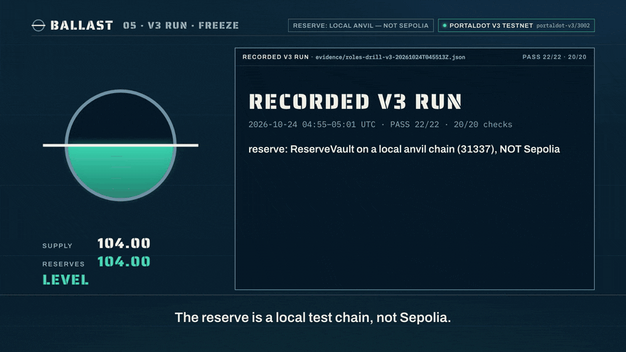
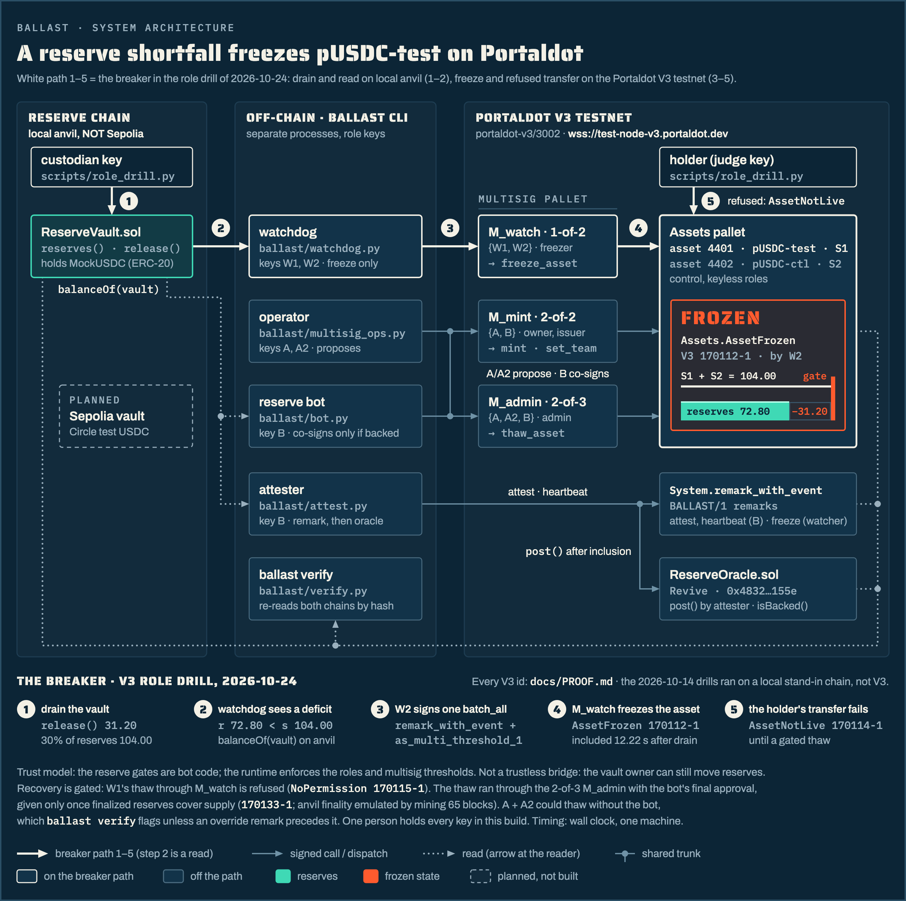
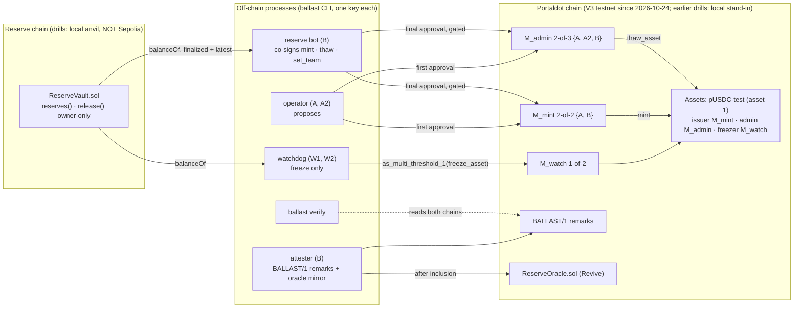

<a id="ballast"></a>

<div align="center">
  
  <h1>Ballast ⚓</h1>
  <p><em>A reserve-gated circuit breaker for a custodial test dollar, built from the Assets and Multisig pallets.</em></p>
  

  <br/>

  [](https://ballast.edycu.dev)
  [](https://github.com/edycutjong/portaldot-hackathon-2026-ballast-edycu/blob/main/docs/pitch-deck.pdf)
  [](https://youtu.be/jV5dCy1o3O8)
  [](https://dorahacks.io/build/50247)
  [](https://dorahacks.io/hackathon/portaldot-hacker-house-2026/detail)

  <br/>

  
  [](https://github.com/edycutjong/portaldot-hackathon-2026-ballast-edycu/releases/latest)
  [](https://github.com/edycutjong/portaldot-hackathon-2026-ballast-edycu/actions/workflows/ci.yml)
  
  
  
  

</div>

---

<div align="center">
  
  <br/><sub>B-roll: the V3 freeze run (1.6× speed) · <a href="https://youtu.be/jV5dCy1o3O8">full demo video</a></sub>
</div>

**On 2026-10-24 it ran on the Portaldot V3 testnet: role split, watcher freeze, bot-gated thaw and attestations, every V3 extrinsic listed in `docs/PROOF.md`. The reserve in those runs is a local anvil chain, not Sepolia. On 2026-10-30 (UTC) the drill also ran against a real Sepolia `ReserveVault` (below).**

*Portaldot Hacker House 2026 · check-in build. On 2026-10-24 the breaker ran on the Portaldot V3 testnet (`wss://test-node-v3.portaldot.dev`;
genesis, runtime `:code` hash and spec `portaldot-v3`/3002 pinned by the read-only day-0 check of 2026-10-20,
[`evidence/v3-day0-20261020T152616Z.json`](evidence/v3-day0-20261020T152616Z.json)): the role split on assets 4401/4402, `ReserveOracle` deployed
through Revive, a watcher freeze, a refused freezer thaw, a bot-gated thaw and `BALLAST/1` attestations. That is 79 V3 extrinsics across 8 runs
(4 ERROR runs kept as history), each re-queried at or below the finalized head, in [`docs/PROOF.md`](docs/PROOF.md). The reserve in those runs is a
**local anvil chain, NOT Sepolia**. On 2026-10-30 (UTC) a `ReserveVault` was deployed on Ethereum Sepolia with 100.00 Circle test USDC and the drill ran against it, including the real finality wait (see the Sepolia paragraph below). Earlier drills ran on a labelled local stand-in chain (`standin-upstream`,
not V3). Every receipt says which chain it came from.*

<a id="project-name"></a>

## 🏷️ Project Name

**Ballast** (repo: `portaldot-hackathon-2026-ballast-edycu`), track: Multi-Chain & Cross-Chain Infra.

<a id="project-overview"></a>

## 💡 Project Overview

### Problem Statement

As far as we found, Portaldot has no stable unit of account. POT is volatile, so a dApp that wants to price in dollars has nothing to
price with. The realistic first step is a **custodial wrapped dollar**, and its failure mode is silent: if the custodian's reserves drain,
every holder keeps trading an IOU that is already worth less than its face value.

### Solution

Ballast defines **pUSDC-test**, a clearly labelled test asset on the Assets pallet, meant to be backed 1:1 by test USDC in a small vault
contract on an EVM chain (Sepolia; the role drills use a local anvil chain, the Sepolia drill a real vault). Safety comes from role separation that the runtime
enforces (thresholds and roles), plus a reserve gate in an off-chain bot:

1. **Breaker.** The Assets *freezer* is a 1-of-N watcher multisig (`M_watch`, `Multisig.as_multi_threshold_1`). A watcher that sees the
   reserve fall below supply freezes the asset; a holder's `Assets.transfer` is then refused (`Assets.AssetNotLive`, measured on the stand-in and on V3 as `170114-1`; other transfer paths while frozen were not drilled). The freezing
   extrinsic carries the reason as a `BALLAST/1|freeze` remark.
2. **Inert freezer.** A watcher's thaw attempts (`thaw_asset` and `thaw` of one account) fail with `Assets.NoPermission` (measured). The freezer role is for freeze-type calls (`freeze_asset`, `freeze`, `block`; other
   freezer-origin calls such as `touch_other` exist and were not drilled); mint and re-team stay with `M_mint`, and no drill has yet tried a watcher mint or `set_team`.
3. **Reserve-gated mint.** The issuer is a 2-of-2 multisig (`M_mint`, {operator A, reserve bot B}). The bot co-signs a mint only if
   *finalized* reserves cover supply plus the amount, and never while the asset is frozen.
4. **Gated thaw.** The asset admin is a 2-of-3 multisig (`M_admin`). The bot co-signs a thaw only after finality has passed the drain block
   and finalized reserves cover supply again.
5. **Public record.** The bot posts `BALLAST/1` attestations (and a heartbeat) as on-chain remarks and mirrors each one into a
   `ReserveOracle` contract; `ballast verify` re-reads both chains by block hash and rejects remarks from the wrong signer.

The core flow, shown end to end by `scripts/role_drill.py`: *reserves drop, a watcher freezes pUSDC-test on the Portaldot side, a holder's
transfer fails, reserves come back, finality passes, the admin multisig thaws with the bot's co-signature.*

**Trust model, stated plainly:** Ballast is **not a trustless bridge**. Custody is trusted: whoever owns the vault can move the reserves.
Ballast does not prevent that; it makes it visible and stops the shortfall from being minted over or spreading. In this build one person holds
every operator key (A, A2, B and both watchers), so the separation is enforced by the runtime, not by independent humans. Everything is also
subject to the chain's Root origin (`force_asset_status`); on the V3 testnet a `Sudo` key is set (`5Ca3hX…Xc5J`, [`evidence/v3-day0-20261020T152616Z.json`](evidence/v3-day0-20261020T152616Z.json)), and who controls it is not known to us.

### Blockchain Relevance

The breaker is assembled from pallet-native modules (Assets roles, Multisig, System remarks), with no contract code in the enforcement path,
and it freezes at the asset level, so every transfer is refused rather than one pool's. The one contract that targets Portaldot's EVM layer,
`ReserveOracle`, is a read-only mirror so EVM dApps can ask `isBacked(maxAge)`; it cannot freeze or thaw anything. On the V3 testnet it
is deployed through `Revive.instantiate_with_code` at `0x4832cdb7a89c0539fb2e762ab94fcdb5710a155e` (extrinsic `169960-1`, attester = the bot's
H160, [`evidence/roles-setup-v3.json`](evidence/roles-setup-v3.json)) and receives each attestation after inclusion; it ran on the stand-in's
`Revive` pallet first.

<a id="technical-architecture"></a>

## 🏗️ Technical Architecture



*The breaker path 1–5 from the V3 role drill of 2026-10-24: drain on local anvil (not Sepolia), freeze and refused transfer on the Portaldot V3 testnet. Source: [`docs/architecture.html`](docs/architecture.html).*

Full write-up generated from the code: [`ARCHITECTURE.md`](ARCHITECTURE.md) (components, role map, invariants with the file that enforces each,
what is not built). Diagram source: [`docs/architecture.mmd`](docs/architecture.mmd).

<details>
<summary>Diagram as text (Mermaid)</summary>



</details>

**Core tech stack**

| Layer | Choice | State |
|---|---|---|
| Blockchain platform | **Portaldot V3 testnet** | role split, role drill and attestation drill ran on 2026-10-24 ([`docs/PROOF.md`](docs/PROOF.md)); identity pinned on 2026-10-20 (genesis, `:code`, `portaldot-v3`/3002, 14 decimals, 6000 ms blocks) |
| Chains used | `v3` (the 2026-10-24 runs); `standin-upstream`: polkadot-sdk `substrate-node` (`polkadot-stable2606-3`) in `--dev` mode, **not V3** (the earlier drills) | V3 public; stand-in local |
| Runtime modules | Assets, Multisig, Utility, System, Revive (pallet-native) | used by the code and the drills |
| Client | Python 3.11+, `substrate-interface` 1.8.1, `scalecodec` 1.2.12, `web3` 7 | built |
| Contract language | Solidity 0.8.24: `ReserveVault` (Foundry), `ReserveOracle` (Hardhat) | built; vault on local anvil (role drills) and on Ethereum Sepolia (Sepolia drill), oracle on V3 Revive and the stand-in's Revive |
| Reserve chain | local anvil (role drills); Ethereum Sepolia + Circle test USDC (Sepolia drill) | one vault on Sepolia, 100.00 test USDC |
| Frontend | none | not built |

**Chain profiles.** The code identifies the chain by genesis hash and runtime `:code` hash and refuses a mismatch; every output carries the
profile label. Block-count parameters are derived from the measured block time of the chain in use: on the stand-in (3000 ms blocks, measured
over 20 blocks) that is a heartbeat H = 200 blocks (~10 min), K = 600 for the stale-heartbeat rule, W = 28,800 for the wind-down window and a
polling step N = 2. The `v3` profile is pinned to the live chain; its day-0 block time (6000 ms, median over 20 blocks) gives H = 100,
K = 300, W = 14,400 and N = 2 ([`evidence/v3-chain-2026-10-20-p6.txt`](evidence/v3-chain-2026-10-20-p6.txt)).

<a id="smart-contracts"></a>

## 📜 Smart Contracts

Enforcement is **pallet-native**. The two Solidity contracts (`contracts/`) are the reserve vault and the read-only oracle.

| Pallet call | Used for | Result on the stand-in |
|---|---|---|
| `Assets.create`, `set_metadata`, `set_team`, `transfer_ownership` | create `pUSDC-test`, move owner/issuer to `M_mint`, admin to `M_admin`, freezer to `M_watch` | Ok |
| `Multisig.as_multi` (first + final approval) wrapping `Assets.mint` | reserve-gated mint | executes only with the bot's final approval |
| `Multisig.as_multi_threshold_1(Assets.freeze_asset)` | a watcher freezes through `M_watch`, inside `Utility.batch_all` with a `System.remark_with_event` reason | Ok, `AssetFrozen` |
| `Multisig.as_multi_threshold_1(Assets.thaw_asset)` | a watcher tries to thaw | refused, `Assets.NoPermission` |
| `Assets.transfer` while frozen | holder transfer during a freeze | refused, `Assets.AssetNotLive` |
| `Multisig.as_multi(Assets.thaw_asset)` via `M_admin` | gated thaw | executes only with the bot's final approval |
| `Multisig.as_multi(Assets.set_team)` via `M_mint` | team change | co-signed only if issuer stays `M_mint`, admin stays `M_admin`, freezer unchanged |
| `System.remark_with_event` | `BALLAST/1` attestations, heartbeats, freeze reasons | Ok, `System.Remarked` |
| `Revive.map_account`, `instantiate_with_code`, `call` | deploy and post to `ReserveOracle` | Ok, `Revive.ContractEmitted` |

| Contract | Key functions | Tests | Where it has been deployed |
|---|---|---|---|
| [`contracts/ReserveVault.sol`](contracts/ReserveVault.sol) | `reserves()`, `release(to, amount, redeemId)` (owner only, emits `Released`), `transferOwnership` | 20 Foundry tests | local anvil (chain id 31337) in the role drills; Ethereum Sepolia `0x7ceB…357b` in the Sepolia drill (Sourcify `exact_match`) |
| [`contracts/ReserveOracle.sol`](contracts/ReserveOracle.sol) | `post(...)` (attester only, `pdBlock` must increase), `status()`, `isBacked(maxAge)` | 15 Hardhat tests | V3 Revive (`0x4832…155e`, 2026-10-24) and the stand-in's Revive pallet |

A multisig can report `MultisigExecuted` while the call inside it failed, so every executing multisig receipt records the *inner* result (the
executed rows in `docs/RECEIPTS.md` read `inner Ok`). The freezer's thaw through `as_multi_threshold_1` fails the whole
extrinsic with `Assets.NoPermission` (`170115-1` in the V3 role drill, `6904-2` in the newest stand-in one).

**Receipts.** Every step is a real extrinsic or a real anvil transaction, the newest run of each kind is tabulated with extrinsic id, block hash and tx hash in
[`docs/RECEIPTS.md`](docs/RECEIPTS.md) (older runs are linked), and every run is in raw JSON in [`evidence/`](evidence/). `python scripts/check_receipts.py` re-fetches them from the
chains that recorded them: **486/486 stand-in extrinsics and 111/111 anvil transactions** at the last run
([`evidence/test-run-2026-10-14-p5.txt`](evidence/test-run-2026-10-14-p5.txt)). These are **stand-in receipts, not V3**: the stand-in is a local
`--dev` node with no public explorer, and a fresh node run produces new hashes. **V3 receipts** are in
[`docs/PROOF.md`](docs/PROOF.md), each with a https://node-console.portaldot.dev/ link: `python scripts/check_receipts.py --profile v3` re-fetched
79/79 extrinsics, all at or below the finalized head #170291 ([`evidence/v3-finality.json`](evidence/v3-finality.json)). Three were first included in
a block that lost a fork; the same extrinsic is in the canonical block at the same height, and PROOF.md links that block. V3 IDs: assets 4401
(breaker) and 4402 (control), `ReserveOracle` `0x4832…155e`, role addresses in [`deployments/v3.json`](deployments/v3.json).

**Sepolia.** On 2026-10-30 (UTC) `ReserveVault` was deployed on Ethereum Sepolia at `0x7ceB7c3EBDBCC75e585599e5dd944286F009357b` (owner: the testnet deployer `0xDEf7…9300`, token: Circle test USDC `0x1c7D…7238`), source-verified on Sourcify (`exact_match`; not verified on Etherscan), and funded with exactly 100.00 test USDC (deploy tx `0x6e3fc886…479a`, deposit `0x28d963c4…b245`, both final on publicnode and Tenderly after a wait of about 842 s). The V3 supply was levelled to S1 50.00 + S2 50.00 first (the judge account's 6.00 surplus was burned through `M_admin`, A + A2). The drill then ran against that vault with the real finality wait: the vault owner released 30.00, W1/W2 (two processes, one machine) froze asset 4401 on V3 about 10 s later, the judge transfer was refused (`AssetNotLive`), W1's thaw was refused (`NoPermission`), the owner re-deposited 30.00, and the bot refused the thaw until both providers' finalized head passed the drain (the wait was 1,026 s; finalized `12029641` on both) and only then co-signed it. Clean-pinned PASS: [`evidence/sepolia-drill-20261030T220145Z.json`](evidence/sepolia-drill-20261030T220145Z.json) (8/8 steps, 18/18 state checks; freeze `258434-1`, thaw `258627-1`); the first run, the Sepolia deploy and deposit are in [`evidence/sepolia-drill-20261030T200923Z.json`](evidence/sepolia-drill-20261030T200923Z.json); two `--vault` re-runs between them failed one harness precheck (product steps 8/8) and are kept as history. Every Sepolia transaction was re-read from both providers at or below the finalized head ([`evidence/sepolia-drill-reread-20261030T224700Z.txt`](evidence/sepolia-drill-reread-20261030T224700Z.txt), 20/20). Rows are labelled `Sepolia` in [`docs/PROOF.md`](docs/PROOF.md). The second keyless provider is now Tenderly's public gateway because drpc.org's free plan stopped serving Sepolia (error 35, first seen 2026-10-30 UTC).

Reproduce: load the Sepolia key file into the environment (`set -a; . ~/.config/ballast/sepolia.env; set +a`), then `python scripts/sepolia_drill.py [--vault <address>]`; it needs the v3 role seeds and about 35 minutes for the two finality waits.

<a id="installation--setup"></a>

## 🚀 Installation & Setup

**Requirements:** Python 3.11+, Node.js and npm (tested on v22), [Foundry](https://getfoundry.sh) (`forge`, `anvil`), `curl`, `lsof`. The stand-in node needs
the prebuilt `substrate-node` for `polkadot-stable2606-3` (release URL in the header comment of `scripts/standin_node.sh`, sha256 as its `SHA256=` default); tested on macOS arm64
only. The unit tests need no node.

```bash
git clone --recurse-submodules https://github.com/edycutjong/portaldot-hackathon-2026-ballast-edycu.git
cd portaldot-hackathon-2026-ballast-edycu

python3 -m venv .venv && . .venv/bin/activate
pip install -e '.[dev]'
cp ballast.toml.example ballast.toml        # profile = standin-upstream, ws://127.0.0.1:49944

pytest -q                                   # 239 tests, offline (metadata fixtures are sha256-pinned)
forge test                                  # 20 ReserveVault tests
npm ci && npx hardhat test                  # 15 ReserveOracle tests

# the stand-in chain and the local reserve chain (download the node binary first, see scripts/standin_node.sh)
scripts/standin_node.sh start               # RPC on 127.0.0.1:49944, no peers
scripts/anvil_local.sh start                # local anvil on 127.0.0.1:49545, chain id 31337
ballast chain                               # identify the chain, print its label and block-derived constants

python scripts/spike_assets.py              # Assets + Multisig spike: freeze, refused thaw, refused transfer, admin thaw
ballast drill --scenario drain              # drain a local vault -> a watcher freezes -> the judge's transfer is refused
ballast drill --scenario outage             # every provider unreachable -> fail-closed freeze (15 s drill override)
ballast drill --scenario heartbeat          # the bot goes silent -> freeze (K = 10 blocks, drill override)

rm deployments/standin-upstream.json        # only on a NEW chain: the committed manifest is from the author's chain, setup_roles refuses to overwrite it
python scripts/setup_roles.py               # ONCE per chain: role split, control asset, vault, oracle -> deployments/<profile>.json
python scripts/role_drill.py                # gated mint, refused over-mint, freeze, gated thaw, team gate
python scripts/attest_drill.py              # attestations, oracle mirror, `ballast verify`, forged remark REJECTED
python scripts/oracle_standin.py            # ReserveOracle on the stand-in's Revive: isBacked false -> true -> false (values copied from a drill)

ballast verify                              # re-check every BALLAST/1 remark on both chains
python scripts/check_receipts.py            # re-fetch receipts by extrinsic id (matches only the node that recorded them: on a new chain the committed rows MISMATCH, your own new runs match)
scripts/standin_node.sh stop; scripts/anvil_local.sh stop
```

The unit tests, forge and Hardhat suites also ran from a fresh clone. `setup_roles.py` has set up two chains: the author's stand-in and the V3
testnet (2026-10-24; that run crashed on a message-formatting bug after 8 extrinsics were on chain, 7 of them recorded, and was finished with
`--resume`, which keeps the recorded receipts, recovers the unrecorded one (`169927-1`) from the chain and skips every step already on chain;
the crashed run's own record is [`evidence/crashed-roles-setup-v3-20261024T043731Z.json`](evidence/crashed-roles-setup-v3-20261024T043731Z.json)).

The scripts regenerate `docs/RECEIPTS.md` from `evidence/`. Demo accounts are deterministic dev URIs and every script refuses to use them on a
non-stand-in profile; on `v3` each role key is a mode-600 seed file outside the repo (default `~/.config/ballast`,
`$BALLAST_KEY_DIR`; `scripts/v3_keys.py`). `ballast reserves <holder>` reads any address's USDC balance from Sepolia keylessly; a Sepolia deployment needs
`SEPOLIA_*` variables from a file outside the tree (names in `.env.example`). On `v3`, `scripts/setup_roles.py --profile v3` sizes its funding from
the chain's deposit constants, refuses to start if the funder is short, and deploys the oracle through `Revive.instantiate_with_code`. There is no frontend to launch.

### Development

CI (`.github/workflows/`) is offline: ruff, the pytest suite, forge and Hardhat tests, a package build, CodeQL, gitleaks and pip-audit. It needs no key and does no live RPC write. Run the same checks locally with [`CONTRIBUTING.md`](CONTRIBUTING.md); the V3 and Sepolia drills stay opt-in.

<a id="demo"></a>

## 🎬 Demo

- **Video:** demo: https://youtu.be/jV5dCy1o3O8
- **Pitch deck:** [`docs/pitch-deck.pdf`](docs/pitch-deck.pdf) (10 slides, printed from [`deck/index.html`](deck/index.html); figures pinned to build `0071879`).
- **Live demo:** no hosted UI. The V3 runs are public: every extrinsic in [`docs/PROOF.md`](docs/PROOF.md) opens on https://node-console.portaldot.dev/.
- **What a reviewer can verify without us:** `docs/RECEIPTS.md` (every step with extrinsic ids and hashes), `evidence/` (raw JSON, watchdog logs),
  and the commands above on a fresh chain (they produce new ids and hashes; the committed receipts re-fetch only against the author's node).
- **On V3** (6000 ms blocks, local anvil reserve, wall clock, one machine): drain to freeze included took 12.22 s in the passing V3 role drill
  ([`evidence/roles-drill-v3-20261024T045513Z.json`](evidence/roles-drill-v3-20261024T045513Z.json); that file's note label still says "stand-in",
  a labelling bug fixed after the run; the run's chain is `v3`).
- **The drill in numbers on the stand-in** (wall clock, one machine, local anvil + stand-in, so not a V3 or Sepolia figure):
  drain to freeze included took 5.48 s in the latest role-split drill (the five role-split drills ranged 5.5 to 8.4 s; the earlier four took 7.9 to 8.4 s, one of them on uncommitted code and one on the same `ballast/` code as the latest, so the spread is run-to-run variance on one machine) and 6.33 s in the latest
  scratch-asset drill (the eight passing scratch drills: 6.3 to 6.8 s; in the latest, 3 Portaldot blocks from the head before the drain to the freeze). `ballast verify` over blocks #4076 to #7035 (role-split setup to just after the ReserveOracle run): 25/25 bot attestations pass on both chains, 6 forged
  remarks REJECTED, 0 FAIL or FLAGGED ([`evidence/verify-standin-upstream-p5-fullrange.json`](evidence/verify-standin-upstream-p5-fullrange.json)).
- **Test accounts / data:** deterministic dev keys on the stand-in only; on V3, mode-600 seed files outside the repo. Public role addresses are in
  [`deployments/v3.json`](deployments/v3.json) and [`deployments/standin-upstream.json`](deployments/standin-upstream.json).

<a id="roadmap"></a>

## 🗺️ Roadmap

**Completed (drills on the stand-in first, then on the Portaldot V3 testnet on 2026-10-24)**
- [x] Chain profiles (`v3` pinned to the live chain, `standin-upstream`, `standin-1002`), genesis / `:code` identification, block-time-derived constants
- [x] Assets role split + watcher-set freeze, refused freezer thaw, refused frozen transfer, admin thaw (6 spike runs, 5 PASS and 1 recorded FAIL kept as history)
- [x] `ReserveVault` + 20 Foundry tests; reserve reader on two providers with block-hash pinning; watchdog with deficit, fail-closed and heartbeat rules
- [x] `ReserveOracle` + 15 Hardhat tests; deployed on the stand-in's Revive pallet, then on V3's
- [x] Multisig role split (`M_mint` 2-of-2, `M_admin` 2-of-3, `M_watch` 1-of-2), reserve bot with mint / thaw / set_team gates, SQLite decision log
- [x] `BALLAST/1` attestations, oracle mirror after inclusion, `ballast verify` with per-type signers and a forged-remark negative control
- [x] Portaldot V3 testnet: role split + `ReserveOracle` on Revive (PASS 16/16 + 6/6), role drill PASS 22/22 + 20/20, attestation drill PASS 15/15 + 6/6,
  79/79 V3 extrinsics re-queried and final ([`docs/PROOF.md`](docs/PROOF.md); reserve: local anvil, NOT Sepolia)
- [x] 274 automated tests (239 pytest + 20 forge + 15 Hardhat, [`evidence/test-run-2026-10-24-p12.txt`](evidence/test-run-2026-10-24-p12.txt))

**Next phase**
- [x] `ReserveVault` on Sepolia with 100.00 test USDC and the drill against it, including the real finality wait (2026-10-30 UTC, [`docs/PROOF.md`](docs/PROOF.md))
- [ ] The scratch-asset outage and heartbeat drills on V3 (`ballast drill` targets the stand-in; the role and attestation drills ran on V3)
- [ ] A watcher on separate infrastructure (today both watchers run on one machine)
- [ ] Community-watcher mode, watcher-set rotation, `M_admin` rotation, wind-down branch, `ReserveOracle.trip()`
- [ ] Benchmarks over many drills, reserves page

**Honest limitations**
- Custody is trusted: the vault owner can move reserves. Ballast makes that visible and stops the shortfall from spreading.
- Freezing reads **latest** reserve state and can false-trip on a reorg; recovery is a thaw by `M_admin` once finalized reserves cover supply
  (a multisig round-trip). Mints and thaws use **finalized** state.
- The admin multisig is 2-of-3 {A, A2, B}: A and A2 can thaw without the bot. `ballast verify` flags such a thaw unless an `override` remark
  precedes it, but nothing on chain requires the remark. Losing B ends minting and re-teaming (owner and issuer are `M_mint`); recovery would be a
  new asset plus a migration, which is not built.
- Root can override every role. The off-chain pieces (watchdog, bot, attester) enforce nothing while stopped; the heartbeat rule makes a silent
  bot visible by freezing, but only if a watcher is running.
- `ReserveOracle` is as fresh as the bot's last post; `isBacked(maxAge)` reads `false` when stale, never "backed" by default.
- The drills use drill overrides where noted (fail-closed 15 s instead of 300 s, K = 10 instead of 600) and a mock token on a local anvil
  chain in the role drills, whose finality is emulated by mining 65 blocks; the Sepolia drill waited out real finality (842-1,050 s per wait on 2026-10-30 UTC). Both watchers there ran on one machine.

<a id="team"></a>

## 👥 Team

- **Team name:** edycu
- **Members & roles:** edycu, solo (design, architecture, role map and on-chain design decisions, review)
- **Contact (hackathon only):** GitHub [@edycutjong](https://github.com/edycutjong)

**AI assistance disclosure.** This project was built with Claude Code (Anthropic). Most of the code, the tests and the prose were drafted with
AI assistance and reviewed by the author. The architecture, the role map and the on-chain design decisions are the author's. Libraries used:
`substrate-interface` / `scalecodec`, `web3`, `xxhash`, `pytest`, Foundry and `forge-std`, Hardhat; the stand-in node is the upstream
`polkadot-sdk` `substrate-node` binary, unmodified.

<a id="license"></a>

## 📄 License

[MIT](LICENSE)
