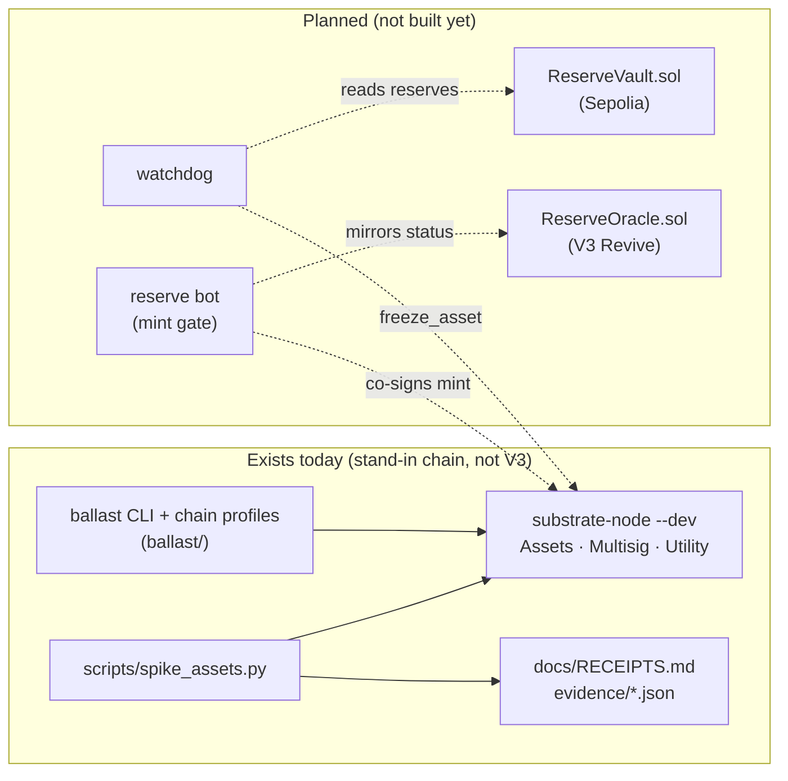

<div align="center">

# Ballast

**A reserve-gated circuit breaker for a test dollar, built on the Assets and Multisig pallets (so far demonstrated on a local stand-in chain, not Portaldot V3).**


*Status: work in progress (Portaldot Hacker House 2026). The Assets + Multisig engine runs on a
labelled local stand-in chain; the Portaldot V3 testnet was unreachable when probed on 2026-10-14 ([`evidence/v3-probe-2026-10-14.txt`](evidence/v3-probe-2026-10-14.txt)).*

</div>

## Project Name

**Ballast** (repo: `portaldot-hackathon-2026-ballast-edycu`), track: Multi-Chain & Cross-Chain Infra.

## Project Overview

### Problem Statement

As far as we found, Portaldot has no stable unit of account. POT is volatile, so a dApp that wants to price in dollars has nothing to
price with. The realistic first step is a **custodial wrapped dollar**, and its failure mode is silent: if the
custodian's reserves drain, every holder keeps trading an IOU that is already worth less than its face value.

### Solution

Ballast defines **pUSDC-test**, a clearly labelled test asset on the Assets pallet (so far created only on the local
stand-in chain, not Portaldot V3), intended to be backed 1:1 by Circle test USDC held in a small vault contract on
Sepolia. Safety is meant to come from role separation that the pallet enforces (shown on the stand-in), not from promises; whether V3 exposes
the same calls is `UNVERIFIED`:

1. **Breaker:** the Assets *freezer* role belongs to a 1-of-N watcher multisig. A watcher can freeze the asset and
   its thaw attempts are refused (stand-in receipts 890-2, 891-2), so a reserve shortfall cannot spread without leaving a public on-chain freeze (shown on the stand-in only; planned for V3).
2. **Admin thaw:** the freezer cannot thaw; the asset admin can (stand-in).
3. **Reserve-gated mint** (planned): the issuer is a multisig in which a reserve bot is a mandatory co-signer.

Only part 1 and the freezer/admin split of part 2 exist today, and only on a stand-in chain (see
[Roadmap](#roadmap)). The core flow we are building toward is: *reserves drop on Sepolia, the watchdog freezes
pUSDC-test on Portaldot, a holder's transfer fails, the admin multisig thaws once reserves are restored.*

**Trust model, stated plainly:** Ballast is **not a trustless bridge**. Custody is trusted: whoever owns the vault can
move the reserves. Ballast does not prevent that; it makes it visible and stops the shortfall from being minted
over or spreading. In this build one person holds the operator keys, so the separation of the bot key is a production
property, not a property of the demo. Everything is also subject to the chain's Root origin (`force_asset_status`),
whose holder on the V3 testnet is `UNVERIFIED`.

### Blockchain Relevance

The breaker is assembled from pallet-native modules (Assets roles, Multisig), demonstrated on the upstream stand-in
(V3 availability `UNVERIFIED`), with no contract code in the enforcement path, and it freezes at the asset level, so every transfer is refused rather than one pool. An EVM
status oracle on V3's EVM/Revive layer (if present, `UNVERIFIED`) is planned as a read-only mirror, never as the enforcement point.

## Technical Architecture



**Core tech stack**

| Layer | Choice | State |
|---|---|---|
| Blockchain platform | **Portaldot V3 testnet** (target) | unreachable; not measured |
| Chain used so far | `standin-upstream`: polkadot-sdk `substrate-node` (`polkadot-stable2606-3`) in `--dev` mode, **not V3** | running locally |
| Runtime modules | Assets, Multisig, Utility (pallet-native) | used by the spike |
| Client | Python 3.11+, `substrate-interface` 1.8.1, `scalecodec` 1.2.12 | built |
| Contract language | Solidity (`ReserveVault` on Sepolia, `ReserveOracle` on Revive) | planned (P3–P4) |
| Reserve chain | Ethereum Sepolia, Circle test USDC | planned (P3–P4) |
| Frontend | none yet | planned |

**Chain profiles.** The code identifies the chain it is talking to by genesis hash and runtime `:code` hash and
refuses a mismatch. Every output carries the profile label. Block-count parameters are derived from the measured
block time of the chain in use: on the stand-in (3000 ms blocks, measured over 20 blocks) that gives a ~10 minute
heartbeat of 200 blocks, 600 for the stale-heartbeat rule, 28,800 for the wind-down window and 2 for the polling
interval. The `v3` profile is a stub whose unknown values read `UNVERIFIED (V3 day-0)`.

## Smart Contracts

Ballast is **pallet-native** so far: there is no deployed contract. `contracts/` is empty on purpose.

| Pallet call | Used for | Result on the stand-in |
|---|---|---|
| `Assets.create`, `set_metadata`, `set_team` | create `pUSDC-test`, set issuer / admin / freezer | Ok |
| `Assets.mint` | issue test supply to a holder | Ok |
| `Multisig.as_multi_threshold_1(Assets.freeze_asset)` | watcher freezes the asset through the 1-of-2 `M_watch` multisig | Ok, `AssetFrozen` |
| `Multisig.as_multi_threshold_1(Assets.thaw_asset)` / `Assets.thaw` | watcher tries to thaw | refused, `Assets.NoPermission` |
| `Assets.transfer` while frozen | holder transfer during a freeze | refused, `Assets.AssetNotLive` |
| `Assets.thaw_asset` by the admin, then `Assets.transfer` | control | Ok |
| `Utility.batch_all` | fund the demo accounts | Ok |

Every step is a real extrinsic. The latest run is tabulated with extrinsic id, block hash and tx hash in
[`docs/RECEIPTS.md`](docs/RECEIPTS.md); all four runs are in raw JSON in [`evidence/`](evidence/). These are **stand-in receipts, not
V3**: the stand-in is a local `--dev` node, there is no public explorer for it, and a fresh node run produces new
hashes. V3 asset and account IDs: none yet.

Observed on the stand-in only (not V3): `mint` while the asset is frozen is also refused (`Assets.AssetNotLive`), and
the 1-of-2 multisig emits `MultisigExecuted` with the locally derived multisig address.

**Planned:** `contracts/ReserveVault.sol` (Sepolia, holds the test USDC) and `contracts/ReserveOracle.sol` (V3 Revive,
read-only status mirror). Neither exists yet.

## Installation & Setup

**Requirements:** Python 3.11+, `curl`, `lsof`. For the local stand-in node: the prebuilt `substrate-node` binary for
`polkadot-stable2606-3` (see `scripts/standin_node.sh`: release URL in the header, sha256 in the `SHA256=` default). It was tested on
macOS arm64 only. The tests need no node.

```bash
# the repo is private until submission; it goes public after a leak scan
git clone https://github.com/edycutjong/portaldot-hackathon-2026-ballast-edycu.git
cd portaldot-hackathon-2026-ballast-edycu

python3 -m venv .venv && . .venv/bin/activate
pip install -e '.[dev]'
cp ballast.toml.example ballast.toml     # profile = standin-upstream, ws://127.0.0.1:49944

pytest -q                                # 52 tests, offline (metadata fixtures are sha256-pinned)

# stand-in chain (download the node binary first, see scripts/standin_node.sh)
scripts/standin_node.sh start            # RPC on 127.0.0.1:49944, no peers
ballast chain                            # identify the chain, print its label and block-derived constants
python scripts/spike_assets.py           # the Assets + Multisig spike; prints one line per extrinsic
python scripts/check_receipts.py         # re-fetch receipts by extrinsic id; matches only the node that recorded them
scripts/standin_node.sh stop
```

The spike regenerates `docs/RECEIPTS.md` from `evidence/` (newest run first) and writes `evidence/spike-assets-<profile>-asset<id>.json`. Demo
accounts are deterministic dev URIs and the scripts refuse to use them on a non-stand-in profile. No deployment step
exists yet because there are no contracts; there is no frontend to launch.

## Demo

- **Video:** coming at check-in.
- **Live demo:** none. The stand-in chain is local and the V3 testnet is unreachable.
- **Test accounts / data:** deterministic dev keys on the stand-in only; see [`docs/RECEIPTS.md`](docs/RECEIPTS.md)
  for the latest run (asset id, extrinsic ids, hashes).

## Roadmap

**Completed**
- [x] Scaffold, MIT license, offline test suite (52 tests)
- [x] Chain profiles (`v3` stub, `standin-upstream`, `standin-1002`) with genesis / `:code` identification and
      block-time-derived constants
- [x] Assets role split + watcher-set freeze, end to end on the stand-in: freeze, refused thaw by the freezer,
      refused frozen transfer, admin thaw control (4 fresh runs, 48 receipts re-fetched by extrinsic id)

**Next phase**
- [ ] `ReserveVault.sol` + Foundry tests; Sepolia reader on two providers; watchdog and `ballast drill`
- [ ] `ReserveOracle.sol` + Hardhat tests
- [ ] Multisig role split (`M_mint`, `M_admin`, `M_watch`), reserve bot with the mint gate, Sepolia deploy
- [ ] On-chain attestations and `ballast verify`
- [ ] Re-run everything on the Portaldot V3 testnet once it is reachable and funded (day-0 checks are
      `UNVERIFIED`: Multisig availability, freezer-cannot-thaw, block time)

## Team

- **Team name:** edycu
- **Members & roles:** edycu, solo (design, architecture, role map and on-chain design decisions, review)
- **Contact (hackathon only):** GitHub [@edycutjong](https://github.com/edycutjong)

**AI assistance disclosure.** This project was built with Claude Code (Anthropic). Most of the code and the tests
were drafted with AI assistance and reviewed by the author. The architecture, the role map and the on-chain design
decisions are the author's. Libraries used: `substrate-interface` / `scalecodec`, `xxhash`, `pytest`;
the stand-in node is the upstream `polkadot-sdk` `substrate-node` binary, unmodified.

## License

[MIT](LICENSE)
