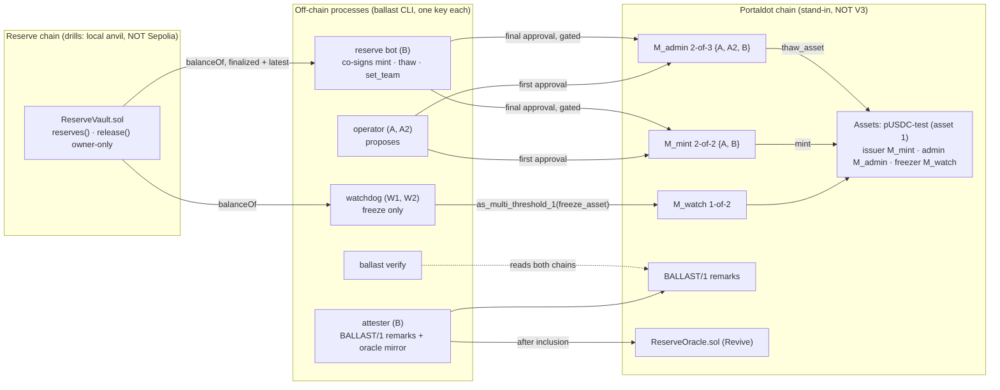

<div align="center">

# Ballast

**A reserve-gated circuit breaker for a custodial test dollar, built from the Assets and Multisig pallets. Everything measured so far ran on a local stand-in chain, not Portaldot V3.**


*Portaldot Hacker House 2026 · check-in build. The Portaldot V3 testnet's DNS names did not resolve when probed on 2026-10-14
([`evidence/v3-probe-2026-10-14-p5.txt`](evidence/v3-probe-2026-10-14-p5.txt)), so the breaker is demonstrated on a labelled
local stand-in chain against a local anvil reserve chain. No Sepolia vault is deployed yet. Every receipt says which chain it came from.*


</div>

## Project Name

**Ballast** (repo: `portaldot-hackathon-2026-ballast-edycu`), track: Multi-Chain & Cross-Chain Infra.

## Project Overview

### Problem Statement

As far as we found, Portaldot has no stable unit of account. POT is volatile, so a dApp that wants to price in dollars has nothing to
price with. The realistic first step is a **custodial wrapped dollar**, and its failure mode is silent: if the custodian's reserves drain,
every holder keeps trading an IOU that is already worth less than its face value.

### Solution

Ballast defines **pUSDC-test**, a clearly labelled test asset on the Assets pallet, meant to be backed 1:1 by test USDC in a small vault
contract on an EVM chain (Sepolia is the target; the drills use a local anvil chain). Safety comes from role separation that the runtime
enforces (thresholds and roles), plus a reserve gate in an off-chain bot:

1. **Breaker.** The Assets *freezer* is a 1-of-N watcher multisig (`M_watch`, `Multisig.as_multi_threshold_1`). A watcher that sees the
   reserve fall below supply freezes the asset; a holder's `Assets.transfer` is then refused (`Assets.AssetNotLive` on the stand-in, measured; other transfer paths while frozen were not drilled). The freezing
   extrinsic carries the reason as a `BALLAST/1|freeze` remark.
2. **Inert freezer.** A watcher's thaw attempts (`thaw_asset` and `thaw` of one account) fail with `Assets.NoPermission` (measured). The freezer role is for freeze-type calls (`freeze_asset`, `freeze`, `block`; other
   freezer-origin calls such as `touch_other` exist and were not drilled); mint and re-team stay with `M_mint`, and no drill has yet tried a watcher mint or `set_team`.
3. **Reserve-gated mint.** The issuer is a 2-of-2 multisig (`M_mint`, {operator A, reserve bot B}). The bot co-signs a mint only if
   *finalized* reserves cover supply plus the amount, and never while the asset is frozen.
4. **Gated thaw.** The asset admin is a 2-of-3 multisig (`M_admin`). The bot co-signs a thaw only after finality has passed the drain block
   and finalized reserves cover supply again.
5. **Public record.** The bot posts `BALLAST/1` attestations (and a heartbeat) as on-chain remarks and mirrors each one into a
   `ReserveOracle` contract; `ballast verify` re-reads both chains by block hash and rejects remarks from the wrong signer.

The core flow, shown end to end by `scripts/role_drill.py`: *reserves drop, a watcher freezes pUSDC-test on the Portaldot side, a holder's
transfer fails, reserves come back, finality passes, the admin multisig thaws with the bot's co-signature.*

**Trust model, stated plainly:** Ballast is **not a trustless bridge**. Custody is trusted: whoever owns the vault can move the reserves.
Ballast does not prevent that; it makes it visible and stops the shortfall from being minted over or spreading. In this build one person holds
every operator key (A, A2, B and both watchers), so the separation is enforced by the runtime, not by independent humans. Everything is also
subject to the chain's Root origin (`force_asset_status`); who holds Root on the V3 testnet is `UNVERIFIED`.

### Blockchain Relevance

The breaker is assembled from pallet-native modules (Assets roles, Multisig, System remarks), with no contract code in the enforcement path,
and it freezes at the asset level, so every transfer is refused rather than one pool's. The one contract that targets Portaldot's EVM layer,
`ReserveOracle`, is a read-only mirror so EVM dApps can ask `isBacked(maxAge)`; it cannot freeze or thaw anything. It has only been deployed
on the stand-in's `Revive` pallet; whether V3 accepts the same deployment is `UNVERIFIED`.

## Technical Architecture

Full write-up generated from the code: [`ARCHITECTURE.md`](ARCHITECTURE.md) (components, role map, invariants with the file that enforces each,
what is not built). Diagram source: [`docs/architecture.mmd`](docs/architecture.mmd).



**Core tech stack**

| Layer | Choice | State |
|---|---|---|
| Blockchain platform | **Portaldot V3 testnet** (target) | DNS did not resolve on 2026-10-14; nothing measured on it |
| Chain used | `standin-upstream`: polkadot-sdk `substrate-node` (`polkadot-stable2606-3`) in `--dev` mode, **not V3** | running locally |
| Runtime modules | Assets, Multisig, Utility, System, Revive (pallet-native) | used by the code and the drills |
| Client | Python 3.11+, `substrate-interface` 1.8.1, `scalecodec` 1.2.12, `web3` 7 | built |
| Contract language | Solidity 0.8.24: `ReserveVault` (Foundry), `ReserveOracle` (Hardhat) | built; vault on local anvil only, oracle on the stand-in's Revive only |
| Reserve chain | local anvil (drills); Ethereum Sepolia + Circle test USDC (target) | Sepolia read-only so far |
| Frontend | none | not built |

**Chain profiles.** The code identifies the chain by genesis hash and runtime `:code` hash and refuses a mismatch; every output carries the
profile label. Block-count parameters are derived from the measured block time of the chain in use: on the stand-in (3000 ms blocks, measured
over 20 blocks) that is a heartbeat H = 200 blocks (~10 min), K = 600 for the stale-heartbeat rule, W = 28,800 for the wind-down window and a
polling step N = 2. The `v3` profile is a stub whose unknown values read `UNVERIFIED (V3 day-0)`.

## Smart Contracts

Enforcement is **pallet-native**. The two Solidity contracts (`contracts/`) are the reserve vault and the read-only oracle.

| Pallet call | Used for | Result on the stand-in |
|---|---|---|
| `Assets.create`, `set_metadata`, `set_team`, `transfer_ownership` | create `pUSDC-test`, move owner/issuer to `M_mint`, admin to `M_admin`, freezer to `M_watch` | Ok |
| `Multisig.as_multi` (first + final approval) wrapping `Assets.mint` | reserve-gated mint | executes only with the bot's final approval |
| `Multisig.as_multi_threshold_1(Assets.freeze_asset)` | a watcher freezes through `M_watch`, inside `Utility.batch_all` with a `System.remark_with_event` reason | Ok, `AssetFrozen` |
| `Multisig.as_multi_threshold_1(Assets.thaw_asset)` | a watcher tries to thaw | refused, `Assets.NoPermission` |
| `Assets.transfer` while frozen | holder transfer during a freeze | refused, `Assets.AssetNotLive` |
| `Multisig.as_multi(Assets.thaw_asset)` via `M_admin` | gated thaw | executes only with the bot's final approval |
| `Multisig.as_multi(Assets.set_team)` via `M_mint` | team change | co-signed only if issuer stays `M_mint`, admin stays `M_admin`, freezer unchanged |
| `System.remark_with_event` | `BALLAST/1` attestations, heartbeats, freeze reasons | Ok, `System.Remarked` |
| `Revive.map_account`, `instantiate_with_code`, `call` | deploy and post to `ReserveOracle` | Ok, `Revive.ContractEmitted` |

| Contract | Key functions | Tests | Where it has been deployed |
|---|---|---|---|
| [`contracts/ReserveVault.sol`](contracts/ReserveVault.sol) | `reserves()`, `release(to, amount, redeemId)` (owner only, emits `Released`), `transferOwnership` | 20 Foundry tests | local anvil (chain id 31337) only. **Not on Sepolia** |
| [`contracts/ReserveOracle.sol`](contracts/ReserveOracle.sol) | `post(...)` (attester only, `pdBlock` must increase), `status()`, `isBacked(maxAge)` | 15 Hardhat tests | the stand-in's Revive pallet only. **Not on V3** |

A multisig can report `MultisigExecuted` while the call inside it failed, so every executing multisig receipt records the *inner* result (the
executed rows in `docs/RECEIPTS.md` read `inner Ok`). The freezer's thaw through `as_multi_threshold_1` fails the whole
extrinsic with `Assets.NoPermission` (`6904-2` in the newest role-split drill).

**Receipts.** Every step is a real extrinsic or a real anvil transaction, the newest run of each kind is tabulated with extrinsic id, block hash and tx hash in
[`docs/RECEIPTS.md`](docs/RECEIPTS.md) (older runs are linked), and every run is in raw JSON in [`evidence/`](evidence/). `python scripts/check_receipts.py` re-fetches them from the
chains that recorded them: **486/486 stand-in extrinsics and 111/111 anvil transactions** at the last run
([`evidence/test-run-2026-10-14-p5.txt`](evidence/test-run-2026-10-14-p5.txt)). These are **stand-in receipts, not V3**: the stand-in is a local
`--dev` node with no public explorer, and a fresh node run produces new hashes. V3 asset, account and contract IDs: none.

**Sepolia.** The reserve reader works against the real Sepolia USDC contract through two keyless providers (publicnode and drpc agree on
finalized block #11913933, `evidence/sepolia-crosscheck-2026-10-14-p5.json`). The deployer wallet holds 20.00 test USDC, below the 100.00 the
plan needs, so **no `ReserveVault` has been deployed or funded on Sepolia and no drill has run against it.**

## Installation & Setup

**Requirements:** Python 3.11+, Node.js and npm (tested on v22), [Foundry](https://getfoundry.sh) (`forge`, `anvil`), `curl`, `lsof`. The stand-in node needs
the prebuilt `substrate-node` for `polkadot-stable2606-3` (release URL in the header comment of `scripts/standin_node.sh`, sha256 as its `SHA256=` default); tested on macOS arm64
only. The unit tests need no node.

```bash
git clone --recurse-submodules https://github.com/edycutjong/portaldot-hackathon-2026-ballast-edycu.git
cd portaldot-hackathon-2026-ballast-edycu

python3 -m venv .venv && . .venv/bin/activate
pip install -e '.[dev]'
cp ballast.toml.example ballast.toml        # profile = standin-upstream, ws://127.0.0.1:49944

pytest -q                                   # 224 tests, offline (metadata fixtures are sha256-pinned)
forge test                                  # 20 ReserveVault tests
npm ci && npx hardhat test                  # 15 ReserveOracle tests

# the stand-in chain and the local reserve chain (download the node binary first, see scripts/standin_node.sh)
scripts/standin_node.sh start               # RPC on 127.0.0.1:49944, no peers
scripts/anvil_local.sh start                # local anvil on 127.0.0.1:49545, chain id 31337
ballast chain                               # identify the chain, print its label and block-derived constants

python scripts/spike_assets.py              # Assets + Multisig spike: freeze, refused thaw, refused transfer, admin thaw
ballast drill --scenario drain              # drain a local vault -> a watcher freezes -> the judge's transfer is refused
ballast drill --scenario outage             # every provider unreachable -> fail-closed freeze (15 s drill override)
ballast drill --scenario heartbeat          # the bot goes silent -> freeze (K = 10 blocks, drill override)

rm deployments/standin-upstream.json        # only on a NEW chain: the committed manifest is from the author's chain, setup_roles refuses to overwrite it
python scripts/setup_roles.py               # ONCE per chain: role split, control asset, vault, oracle -> deployments/<profile>.json
python scripts/role_drill.py                # gated mint, refused over-mint, freeze, gated thaw, team gate
python scripts/attest_drill.py              # attestations, oracle mirror, `ballast verify`, forged remark REJECTED
python scripts/oracle_standin.py            # ReserveOracle on the stand-in's Revive: isBacked false -> true -> false (values copied from a drill)

ballast verify                              # re-check every BALLAST/1 remark on both chains
python scripts/check_receipts.py            # re-fetch receipts by extrinsic id (matches only the node that recorded them: on a new chain the committed rows MISMATCH, your own new runs match)
scripts/standin_node.sh stop; scripts/anvil_local.sh stop
```

The scripts regenerate `docs/RECEIPTS.md` from `evidence/`. Demo accounts are deterministic dev URIs and every script refuses to use them on a
non-stand-in profile. `ballast reserves <holder>` reads any address's USDC balance from Sepolia keylessly; a Sepolia deployment needs
`SEPOLIA_*` variables from a file outside the tree (names in `.env.example`). The oracle's V3 deployment path (Hardhat against the V3 EVM RPC)
is not written because V3 did not resolve. There is no frontend to launch.

## Demo

- **Video:** coming at check-in (≤ 3 min, stand-in labelled on screen).
- **Live demo:** none. The stand-in chain is local and the V3 testnet did not resolve.
- **What a reviewer can verify without us:** `docs/RECEIPTS.md` (every step with extrinsic ids and hashes), `evidence/` (raw JSON, watchdog logs),
  and the commands above on a fresh chain (they produce new ids and hashes; the committed receipts re-fetch only against the author's node).
- **The drill in numbers** (wall clock, one machine, local anvil + stand-in, so not a V3 or Sepolia figure):
  drain to freeze included took 5.48 s in the latest role-split drill (the five role-split drills ranged 5.5 to 8.4 s; the earlier four ran on older or uncommitted code) and 6.33 s in the latest
  scratch-asset drill (the eight passing scratch drills: 6.3 to 6.8 s; in the latest, 3 Portaldot blocks from the head before the drain to the freeze). `ballast verify` over blocks #4076 to #7035 (role-split setup to the last drill): 25/25 bot attestations pass on both chains, 6 forged
  remarks REJECTED, 0 FAIL or FLAGGED ([`evidence/verify-standin-upstream-p5-fullrange.json`](evidence/verify-standin-upstream-p5-fullrange.json)).
- **Test accounts / data:** deterministic dev keys on the stand-in only. Public role addresses are in
  [`deployments/standin-upstream.json`](deployments/standin-upstream.json).

## Roadmap

**Completed (all on the stand-in; none on V3)**
- [x] Chain profiles (`v3` stub, `standin-upstream`, `standin-1002`), genesis / `:code` identification, block-time-derived constants
- [x] Assets role split + watcher-set freeze, refused freezer thaw, refused frozen transfer, admin thaw (6 spike runs, 5 PASS and 1 recorded FAIL kept as history)
- [x] `ReserveVault` + 20 Foundry tests; reserve reader on two providers with block-hash pinning; watchdog with deficit, fail-closed and heartbeat rules
- [x] `ReserveOracle` + 15 Hardhat tests; deployed on the stand-in's Revive pallet
- [x] Multisig role split (`M_mint` 2-of-2, `M_admin` 2-of-3, `M_watch` 1-of-2), reserve bot with mint / thaw / set_team gates, SQLite decision log
- [x] `BALLAST/1` attestations, oracle mirror after inclusion, `ballast verify` with per-type signers and a forged-remark negative control
- [x] 259 automated tests (224 pytest + 20 forge + 15 Hardhat)

**Next phase**
- [ ] Deploy `ReserveVault` on Sepolia with 100.00 test USDC and run the drill against it, including the finality wait (needs faucet claims)
- [ ] Re-run everything on the Portaldot V3 testnet once it is reachable and funded; day-0 checks `UNVERIFIED`: Multisig availability, freezer-cannot-thaw, EVM-bytecode support in Revive, block time
- [ ] A watcher on separate infrastructure (today both watchers run on one machine)
- [ ] Community-watcher mode, watcher-set rotation, `M_admin` rotation, wind-down branch, `ReserveOracle.trip()`
- [ ] Benchmarks over many drills, reserves page

**Honest limitations**
- Custody is trusted: the vault owner can move reserves. Ballast makes that visible and stops the shortfall from spreading.
- Freezing reads **latest** reserve state and can false-trip on a reorg; recovery is a thaw by `M_admin` once finalized reserves cover supply
  (a multisig round-trip). Mints and thaws use **finalized** state.
- The admin multisig is 2-of-3 {A, A2, B}: A and A2 can thaw without the bot. `ballast verify` flags such a thaw unless an `override` remark
  precedes it, but nothing on chain requires the remark. Losing B ends minting and re-teaming (owner and issuer are `M_mint`); recovery would be a
  new asset plus a migration, which is not built.
- Root can override every role. The off-chain pieces (watchdog, bot, attester) enforce nothing while stopped; the heartbeat rule makes a silent
  bot visible by freezing, but only if a watcher is running.
- `ReserveOracle` is as fresh as the bot's last post; `isBacked(maxAge)` reads `false` when stale, never "backed" by default.
- The drills use drill overrides where noted (fail-closed 15 s instead of 300 s, K = 10 instead of 600) and a mock token on a local anvil
  chain, whose finality is emulated by mining 65 blocks. Sepolia's real finality (~13-19 min) has not been exercised in a drill.

## Team

- **Team name:** edycu
- **Members & roles:** edycu, solo (design, architecture, role map and on-chain design decisions, review)
- **Contact (hackathon only):** GitHub [@edycutjong](https://github.com/edycutjong)

**AI assistance disclosure.** This project was built with Claude Code (Anthropic). Most of the code, the tests and the prose were drafted with
AI assistance and reviewed by the author. The architecture, the role map and the on-chain design decisions are the author's. Libraries used:
`substrate-interface` / `scalecodec`, `web3`, `xxhash`, `pytest`, Foundry and `forge-std`, Hardhat; the stand-in node is the upstream
`polkadot-sdk` `substrate-node` binary, unmodified.

## License

[MIT](LICENSE)
